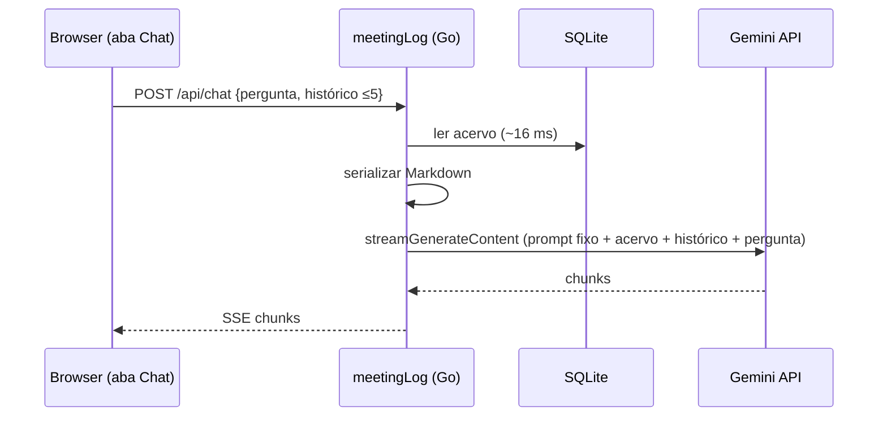

# ADR-002: Arquitetura do Chat — acervo inteiro no contexto do Gemini

**Status:** Aceito  
**Data:** 2026-11-06

## Contexto

O **Chat** responde perguntas em linguagem natural sobre Reuniões, Participantes, Projetos e Instituições: perguntas relacionais/agregadas e perguntas de conteúdo (Notas). Só leitura, só com sessão autenticada (nunca em `/p/{token}`). Discussão: issues #1–#6.

Fatos: acervo inteiro ~82k–110k tokens (~10% do contexto de 1M); crescimento ~15k tokens/ano; sem FTS; CSP `connect-src 'self'` obriga proxy no backend. Custo por pergunta (`gemini-3.8-flash`): ~$0,07 sem cache, ~$0,007 com cache.

## Decisões

### 1. Acervo inteiro no contexto

Cada pergunta envia o acervo completo ao Gemini. Sem text-to-SQL, RAG nem tool-calling.

Alternativas rejeitadas: text-to-SQL (fraco em conteúdo das Notas; exige guarda read-only); RAG (exige índice/embeddings; fraco em agregados); tool-calling (mais código e mais idas ao modelo). Risco aceito: contagens sobre centenas de Reuniões podem errar; se isso aparecer na prática, adicionar uma tool de contagem exata (híbrido).

### 2. Serialização em Markdown compacto

Um bloco por Reunião: id, data/hora, tipo, Projetos, Participantes, Instituições, Pautas, Links, nomes de Anexos, Notas (HTML → texto). Depois as fichas de Participante, Projeto e Instituição. Itens inativos levam o marcador `(inativo)`. Conteúdo de Anexos fica fora.

### 3. Cache por prefixo estável, acervo gerado a cada pergunta

O prompt de sistema é `regras fixas + acervo`, idêntico entre perguntas enquanto os dados não mudam, para aproveitar o cache implícito do Gemini (mínimo 4.096 tokens, leitura a 10%). A data de hoje vai na última mensagem do usuário, não no prefixo. Cache explícito (`cachedContents`) só se o implícito não acertar na prática.

Revisão na implementação: o fingerprint (`MAX(updated_at)` + contagens) foi descartado. Gerar o acervo leva ~16 ms (626 Reuniões, ~340 KB), então o servidor o gera a cada pergunta, sem cópia em memória. Isso evita acervo velho: `atualizado_em` só muda com edições da Reunião, não de Participantes, Projetos, Pautas ou Links.

### 4. Provedor e configuração

Gemini via HTTP direto (sem SDK). Chave em `GEMINI_API_KEY` (env; sem chave, o Chat fica desabilitado). Modelo na tabela `settings`. Usar tier pago: o free tier usa os dados para treino.

### 5. Prompt fixo no código

Injeta a data de hoje (datas relativas). Regras: inativos incluídos e marcados; responder só com base no acervo, senão "não encontrei"; sempre citar `[Reunião #id]`; responder em português.

### 6. Histórico só no browser

`sessionStorage`. As últimas 5 trocas vão ao servidor, que valida (papéis `user`/`model`, ≤5 trocas, ≤4.000 caracteres por mensagem).

### 7. UX

Aba nova "Chat". Streaming SSE sobre `POST`; texto parcial como texto simples, citações `[Reunião #id]` viram links para o `MeetingInfoModal` ao final. Botão "Copiar" por resposta (Markdown via `navigator.clipboard`); sem exportação `.md`.

### 8. Testes

`httptest.Server` imitando a API do Gemini (sem interface com uma implementação). Teste no `store` para a serialização; testes do handler para stream SSE, histórico cortado, entrada inválida, 401 sem sessão e 503 sem chave.

## Diagrama

